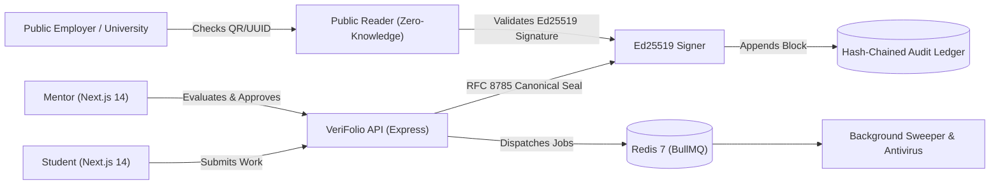

# VeriFolio - Mentor-Verified Skill Portfolios

VeriFolio is an educational skill portfolio and institutional credential verification platform. It allows students to document authentic projects and skills, while enabling mentors and institutions to cryptographically verify, seal, and issue tamper-proof achievements.

---
 
## Architecture Overview



---

## Quickstart (One Command Run)

### Local Development
```bash
# 1. Install dependencies
pnpm install

# 2. Build all workspaces
pnpm build

# 3. Run all tests
pnpm test

# 4. Start development servers
pnpm dev
```

### Production Deployment (Docker Compose)
```bash
# Start all 7 services with healthchecks and persistent volumes:
docker compose -f docker-compose.prod.yml up -d --build
```
- **Web App**: http://localhost:3000
- **API Server**: http://localhost:4000
- **Mock ERP**: http://localhost:4001
- **MinIO Console**: http://localhost:9001

---

## Key Features

1. **Role-Based Portals**:
   - **Student**: Build project entries, link evidence files, request mentor verification.
   - **Mentor**: Review assigned student claims, grade with rubrics, issue verified approvals.
   - **Admin**: Sync institutional rosters via CSV, monitor audit hash-chain integrity, manage skills taxonomy.
   - **Public Verifier**: Instant signature verification with zero PII leakage.
2. **Cryptographic Sealing Engine**:
   - Deterministic RFC 8785 JSON canonicalization.
   - Ed25519 institutional key pair signing.
   - Append-only SHA-256 hash-chained audit ledger.
3. **Security & Reliability**:
   - PostgreSQL Row-Level Security (RLS) on all 14 private tables.
   - 24-hour sliding window idempotency engine (`Idempotency-Key` header).
   - Rate limiting, security headers, request correlation IDs (`X-Request-ID`).
   - Multi-stage non-root Alpine Docker containers.

---

## Available Scripts

| Command | Description |
| :--- | :--- |
| `pnpm build` | Compiles shared types and builds all applications. |
| `pnpm lint` | Runs strict TypeScript checks across all packages. |
| `pnpm typecheck` | Typechecks every app and package. |
| `pnpm test` | Executes the complete Vitest unit, API, and golden vector test suite. |
| `pnpm dev` | Starts API, Web, Mock-ERP, and Worker concurrently. |

---

## Environment Variables

| Variable | Default | Purpose |
| :--- | :--- | :--- |
| `PORT` | `4000` | Port for the API server. |
| `DATABASE_URL` | `postgres://...` | Connection string for PostgreSQL 16. |
| `REDIS_URL` | `redis://localhost:6379` | BullMQ queue and rate-limiting store. |
| `JWT_SECRET` | `secret` | Signing key for authentication tokens. |
| `CORS_ORIGIN` | `http://localhost:3000` | Allowed origins for web clients. |
| `S3_ENDPOINT` | `http://localhost:9000` | MinIO or AWS S3 endpoint. |

---

## Compliance & Standards
- Strictly adheres to the narrow "verified" claim standard (never "certified" or "guaranteed").
- WCAG AA 4.5:1 contrast compliance across all glassmorphic components.
- Zero student PII shared with external AI services.
