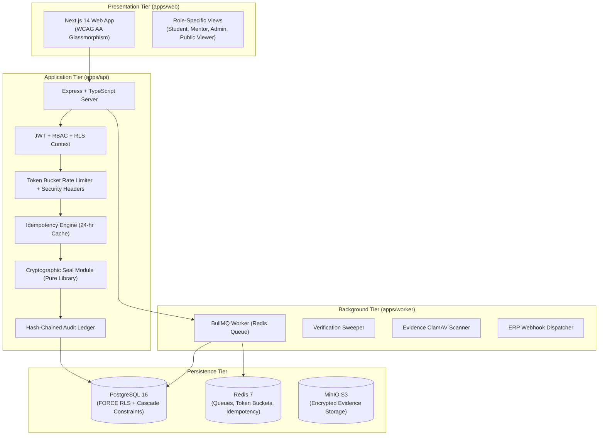

# VeriFolio Architecture Specification

## 1. System Overview
VeriFolio is an educational skill portfolio verification platform that bridges student self-reported project claims with cryptographically sealed mentor attestations. 

## 2. Cryptographic Sealing Pipeline
The seal mechanism guarantees tamper-proof verification badges that can be validated offline by third-party universities or employers.

1. **Payload Canonicalization**:
   The verification payload (entry ID, student ID, mentor ID, school ID, rubric score, approved timestamp, skill taxonomy IDs) is normalized via RFC 8785 JSON Canonicalization Scheme (JCS).
2. **SHA-256 Digest**:
   A deterministic 256-bit hash digest is produced over the canonical bytes.
3. **Ed25519 Signature**:
   The school's active private key signs the digest:
   $$\text{Seal} = \text{Sign}_{\text{Ed25519}}(\text{PrivateKey}_{\text{school}}, \text{SHA-256}(\text{CanonicalPayload}))$$
4. **Append-Only Hash Chain**:
   Each approved verification appends an immutable block to the audit log:
   $$H_n = \text{SHA-256}(H_{n-1} \parallel \text{EventData}_n \parallel \text{Seal}_n)$$
   Any retroactive edit breaks the chain continuity immediately, flagged by `GET /api/v1/admin/audit/integrity`.

## 3. Defense-in-Depth Security
- **PostgreSQL Row-Level Security (RLS)**:
  Every private table has `FORCE ROW LEVEL SECURITY`. Application queries pass `SET LOCAL app.current_school_id = ...` and `SET LOCAL app.current_user_id = ...`. Tenant leakage is impossible at the SQL engine level.
- **Role-Based Access Control (RBAC)**:
  Strict server-side enforcement across 5 roles: `STUDENT`, `MENTOR`, `ADMIN`, `VIEWER`, `PUBLIC_READER`.
- **Public Reader Isolation**:
  The public check page operates under an isolated database role with execution rights restricted exclusively to verification validation functions. Private school data, notes, and records are never queried.
- **Privacy Shield**:
  Under 18 student data is protected. Minor PII (legal names, contacts, attendance, marks) is strictly masked and never dispatched to external LLMs or third parties.
