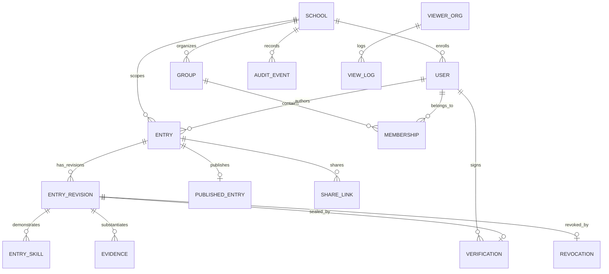
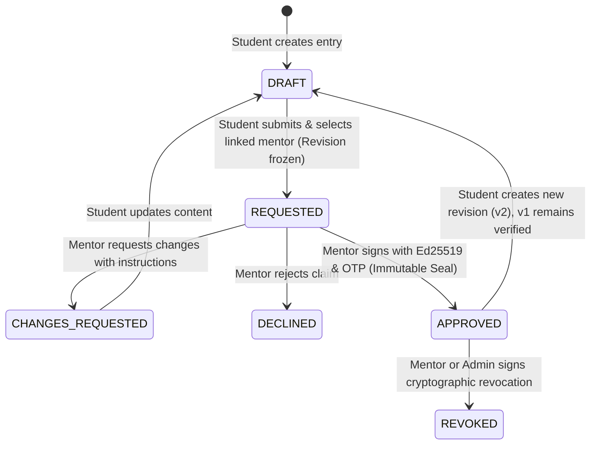

# VeriFolio Domain Model

## 1. Domain Overview & Purpose
**VeriFolio** is a mentor-verified skill portfolio platform for educational institutions (schools, academies, universities). Its purpose is to record, verify, and cryptographically seal student co-curricular, extracurricular, and project-based achievements.

### Core Claim & Philosophy
- **Narrow Verified Claim**: "A named, roster-linked mentor confirmed these skills at these levels on this date and the content has not changed."
- It **never** claims a skill was formally examined.
- It **never** receives or stores grades, marks, attendance records, disciplinary data, or health records.
- **Privacy by Default**: Minors require recorded guardian consent before any public publishing; minor portfolios expose only first names and class level (zero contact details, emails, or phone numbers).

---

## 2. Key Entities and Relationships

### Entity Definitions
1. **School**: The multi-tenant root. Every private record carries `school_id` and is isolated via PostgreSQL Row-Level Security (RLS).
2. **User**: Represents Students, Mentors, School Admins, and Organization Viewers.
   - `role`: `STUDENT` | `MENTOR` | `ADMIN` | `VIEWER`.
   - `is_minor`: Boolean flag triggering minor privacy protections.
   - `erp_ref`: External identifier from school ERP (e.g. `STU-101`, `FAC-201`).
3. **Group**: Educational context linking students and mentors (e.g. classes, clubs, sports teams).
   - `category`: `CLASS` | `CLUB` | `TEAM`.
4. **Membership**: Connects a User to a Group with a role (`STUDENT`, `TEACHER`, `COACH`, `ADVISOR`). A mentor may only verify an entry if they share at least one group membership with the authoring student.
5. **Entry & EntryRevision**:
   - `Entry`: Stable container representing a project, sport, or club achievement.
   - `EntryRevision`: Immutable historical revision (`DRAFT` -> `REQUESTED` -> `CHANGES_REQUESTED` -> `APPROVED` -> `DECLINED` -> `REVOKED`). Once verification is requested, the revision is frozen.
6. **Skill & EntrySkill**:
   - Controlled taxonomy of ~150 skills across 8 families (Technology, Science, Arts, Sports, Leadership, Communication, Community, Enterprise).
   - `level`: `BEGINNER` | `INTERMEDIATE` | `ADVANCED`.
   - `source`: `STUDENT` | `AI` | `MENTOR`.
7. **Evidence**: File attachment (video, pdf, image) verified with SHA-256 hash digest, mime type, size, and antivirus scan status.
8. **Verification & Cryptographic Seal**:
   - Written exclusively by the verifying mentor in a single atomic transaction.
   - Requires substantive mentor note (min 20 characters, written by mentor, never pre-filled).
   - **RFC 8785 Canonical JSON** representation of canonical fields hashed via SHA-256 and signed with **RFC 8032 Ed25519** private key.
9. **AuditEvent (Hash-Chained Audit Trail)**:
   - Insert-only log of every state change, verification, revocation, and roster import.
   - Each event contains `prev_hash` linking to the previous block, creating an immutable cryptographic chain per school.
10. **Consent**: Guardian reference, timestamp, notice version, and scope (`ALL_VERIFIED_ENTRIES`) for minors. Immediate withdrawal purges public search read models.
11. **PublishedEntry**: De-normalized public read model for public check pages and organization viewer queries. Never exposes student contact details.
12. **ViewerOrg & ViewLog**: Approved employer or admissions organizations with audited, rate-limited access.

---

## 3. State Machine: Entry Lifecycle

---

## 4. ERP & School Integration Touchpoints
- **Roster Ingestion**: Scheduled or manual CSV / REST sync matching `erp_ref`. Never auto-merges duplicate people records; flags duplicates for administrative resolution.
- **Outbound Webhooks**: Dispatched on `entry.verified`, `entry.changed`, and `entry.revoked` with HMAC-SHA256 signature (`x-verifolio-signature`) and a 5-minute replay defense timestamp window (`x-verifolio-timestamp`).
- **OIDC/SSO**: External school identity provider mapping to internal user roles.

---

## 5. Domain Boundary Exclusions (Non-Applicable Areas)
As defined by the product specification:
- **No Financial Ledger**: No invoices, double-entry bookkeeping, credit/debit notes, GST/VAT, or currency conversions.
- **No Inventory/Physical Goods**: No stock movements, warehouse locations, or stock valuation (FIFO/LIFO).
- **No Academic Grading**: No marks, GPA, test scores, or attendance records.
